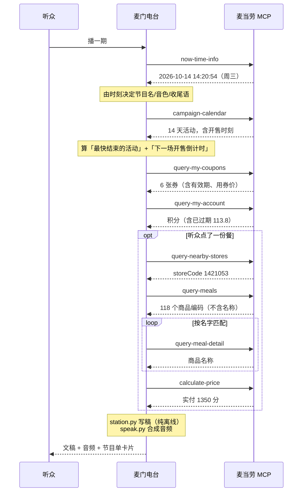

# MCP 接入说明

本项目基于麦当劳中国官方 MCP Server（`https://mcp.mcd.cn`，Streamable HTTP +
Bearer 鉴权）开发。

## 一、使用的工具

共编排 **8 个工具**，全部为**只读**调用。

| 工具 | 用途 | 关键入参 |
|---|---|---|
| `now-time-info` | 服务器时间。**电台报时必须用它，不能用本机时间** | 无 |
| `campaign-calendar` | 当月活动日历，用于「今日现场」与「今日代号」 | 无 |
| `query-my-coupons` | 券包，用于「听众信箱」的临期提醒 | 无 |
| `query-my-account` | 积分账户，用于提醒临期/已过期积分 | 无 |
| `query-nearby-stores` | 按城市 + 关键词找门店，拿 `storeCode` | `beType`、`searchType`、`city`、`keyword` |
| `query-meals` | 门店菜单，只返回商品编码 | `orderType`、`beType`、`storeCode` |
| `query-meal-detail` | 查商品名称与套餐组成 | 上者 + `code` |
| `calculate-price` | 服务端真实核价，单位为**分** | 上者 + `items[]` |

另有 `tools/list` 用于开发期探测工具清单与入参 schema（见 `scripts/probe_mcp.py`）。

**不使用的工具**：`auto-bind-coupons`、`create-order`、`cancel-order`、
`draw-lottery`、`mall-create-order` 等全部写操作。电台只读，不替听众做决定。

---

## 二、调用流程



**分工是刻意的**：

- **取数**由模型在 WorkBuddy 中调用 MCP 完成（或由 `broadcast.py` 直连完成）
- **写稿**由 `station.py` 纯离线完成，不做任何网络请求
- **合成**由 `speak.py` 调用系统 TTS 完成

这样拆分之后，文稿可以被离线复现和 diff。实测结论：用 `fixtures/` 里脱敏后的
样本跑出来的文稿，与实时播出的那一期**逐字一致**，唯一差异是时间戳。

---

## 三、实测得到的字段与行为笔记

以下都是在真实联调中确认过的，写在这里是为了让后续维护者不必再踩一遍。

### 3.1 返回是双通道的

每个工具的结果都同时提供：

- `content[].text` —— 给人看的 Markdown，**里面常常藏着完整的字段规范**
- `structuredContent` —— 给程序用的原始 JSON

两种风格并不统一：`query-my-coupons` 直接给干净的 `data.coupons` 数组，
而 `query-my-account` 把字段说明写进 `text`、原始数据才在 `structuredContent.data`。
所以取数逻辑要按 `success` 信封做**结构性判定**，不要靠猜键名。

### 3.2 `campaign-calendar` 的结构

```
data.currentTime
data.dailyList[]  = { date, dateText, events[] }
  events[]        = { activityCode, activityStage, articleDto{title,content,highlights,...} }
```

- `activityStage`：`2` = 尚未开始，`3` = 已上架/进行中
- `dateText`：当天为「今日」，过去为「往期回顾」，未来为空
- 活动正文里藏着**定时信息**，例如 `10月15日10:45开售`、`APP专享积分抢先购10:40开抢`。
  电台的「下一场开售倒计时」就是从这里抽出来的 —— 这是官方文案里最容易被忽略、
  但对听众最有行动价值的一条数据。

### 3.3 `query-my-coupons` 的字段

券包单券有 60 个字段，与电台相关的：

| 字段 | 说明 |
|---|---|
| `title` | 券名 |
| `discountInfo.discountValue` / `discountTypeText` | **用券价**，如 `13.5` + `¥` |
| `tradeStartDate` / `tradeEndDate` | 有效期 |
| `enable` | 服务端可用开关 |
| `totalAvailableCount` | 剩余可用次数 |

**判定可用性的顺序很重要**：要先看日期区间，再看 `enable`。因为未来才生效的券
`enable` 也可能是 `0`，直接采信会把「未生效」误报成「已失效」——那样电台就会
提前宣布一张券作废，属于典型的数据误读。

`auto-bind-coupons` 重复调用会返回 `data: null`，需要单独处理这个空返回。

### 3.4 `query-meals` 只返回编码

菜单返回的是分类与商品编码，**没有名称**。想按中文名找一份餐，只能逐个调
`query-meal-detail`。一家门店的完整菜单有 118 个编码，实测匹配到「中薯条」
（`4810`）用了 78 次查询。

### 3.5 `calculate-price` 的单位是分

返回的 `price`、`productOriginalPrice`、`discount` 都是**分**。
朗读前必须转成口语形式（`1350` → 「13 块 5」），否则听众会听到一串数字。

### 3.6 已确认的业务错误码

| 错误码 | 含义 | 易踩的点 |
|---|---|---|
| `600012` | 促销规则不支持该商品 | 券必须绑定它自己的促销商品码，不是菜单商品码 |
| `600022` | 暂不支持多张券使用 | 一单只能用一张券 |
| `600050` | 收藏餐厅列表为空 | 需要提供城市 + 关键词 |
| `600058` | 城市名或者关键词不能为空 | **文案说「或」，实际两个都必须传**；且城市名要用短名 `深圳`，`深圳市` 不识别 |

---

## 四、业务价值

| 环节 | 传统做法 | 麦门电台 |
|---|---|---|
| 知道今天有什么活动 | 打开 App 翻活动页 | 报一句「哪场最快结束」，并给出下一场开售的**分钟级**倒计时 |
| 知道券要过期 | 想起来才翻券包 | 主动念出最急的一张，附带剩余天数 |
| 知道积分过期 | 过期了才发现 | 明确说出已过期的数额，并指出「系统不会通知你」 |
| 决定吃什么 | 翻菜单比价 | 直接核价播报，并点名卡包里可能用得上的一张券 |
| 得到一份记录 | 无 | 一期末尾的专属代号 + 可分享的节目单卡片 + 音频 |

**为什么做成一档节目而不是一个查询工具**：麦当劳每天有多少活动、哪张券快过期，
这类信息本身是准确的，但没人愿意主动去查。把它变成一段有开场、有信箱、有收尾
的播音之后，它从「要查的东西」变成了「会被听完的东西」。而节目结构是固定的，
所以它同时也是一个稳定的数据播报口 —— 情绪是入口，准确性是底子。

---

## 五、限流与性能

官方限流为 **600 次/分钟/token**。本项目的调用量集中在按名称匹配商品这一段：
首期需要扫描门店菜单（约 100+ 次 `query-meal-detail`），此后按门店缓存到
`cache/meal-names.json`，第二期起只需几次调用。

节目本身的核心链路只有 4 次只读调用（时间、日历、券包、积分），
不点播的情况下几乎瞬时完成。
